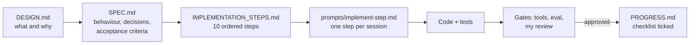

# How I Used AI

This document describes how I used Claude Code to build the knowledge system, and the controls I put around it. The short version: AI proposed, I decided, and every change was checked by tools and by me before it was committed.

## Principles

* **AI surfaces choices, I make the decisions.** For each design question I asked for the options and their trade-offs, then chose. The choice and the reason are recorded in DESIGN.md, in the numbered decisions in SPEC.md (section 21) and in `PROGRESS.md`.
* **Open questions are asked, not assumed.** Claude was told to ask when something was unclear instead of filling the gap silently. Questions were put to me with a recommended option, and I answered each one.
* **AI claims are verified independently.** A claim from the model is not evidence. I checked it against the data, the scorer code or a measurement before accepting it.
* **Nothing is committed without my approval.** Each step ends with a report, and I review the diff and the numbers first.

## Method

I worked top-down, so that each document constrains the next and every piece of code traces back to a requirement.

| Stage | Document | What it fixes |
|---|---|---|
| 1. High-level design | `DESIGN.md` | Requirements, architecture, fast and slow path, conflict rules, technology choices, trade-offs |
| 2. Specification | `SPEC.md` | Exact behaviour, data model, rules, 49 numbered decisions, acceptance criteria AC-1 to AC-14 |
| 3. Implementation steps | `IMPLEMENTATION_STEPS.md` | Ten self-contained steps with goal, scope, tests, verify commands and exit criteria |
| 4. Plan and checklist | Progress checklist at the top of `IMPLEMENTATION_STEPS.md` | Which step is next; a step is ticked only after I approve it |

### Why small, self-contained steps

The full build was broken into ten steps so that each diff stays small enough to review properly, and so that a mistake cannot cascade into later work.

* A step lists the steps it depends on and starts only when they are done (for example, Step 8 depends on Step 7, and Step 9 depends on Steps 6 to 8).
* Each step leaves the repository in a state where `make verify` passes and the public eval runs. Before the answer path existed, a refuse-all stub (Step 2) kept the eval runnable, so the early steps could be checked as "unchanged".
* Each step runs in a fresh session with the same prompt, which reads the checklist, picks the first unticked step and stops after it. A session never starts the next step on its own.
* Each step names the DESIGN and SPEC sections it implements and its own exit criteria. Step 10 closes by checking all of AC-1 to AC-14.

## Deterministic checks

These run on every step through one entry point, `make verify`. They do not depend on the model's judgement.

| Check | Tool |
|---|---|
| Lint and format | `ruff check`, `ruff format --check` |
| Static types | `mypy --strict` on the `kk` package and `tools` |
| Static security | `bandit` on the code, `pip-audit` on dependencies |
| Tests | `pytest` with coverage, run as `python -X dev -W error` so warnings fail the build; unit, golden, property (`hypothesis`) and integration tests |
| Packaging | package build, plus `make cleanroom` (fresh environment, no API key, no network) |
| Eval gate | public eval compared with the committed baseline (`tests/eval_baseline.json`) |

Committed tests use synthetic fixtures that copy the real structure. The snapshot text, `.env`, the extraction cache and the model weights are kept out of git.

## Project skills

Two Claude skills in `.claude/skills/` make the process repeatable. Both are mandatory for every change.

### `verification-first-change` (test first, then measure)

1. Run `make verify` and the eval before any edit, and save the baseline together with the environment (git SHA, key present or not, cache present or not).
2. Write the tests and stubs first, and run them to confirm they fail for the expected reason, not because of an import error.
3. Make the change.
4. Run `make verify` and the eval again, and compare overall accuracy, per-category accuracy, consistency, conflicts, p95 latency, stale-trap hits and errors.
5. Report the full diff, every command with its result, and a before/after table. Any regression is explained by question and goes to me. It is committed only if I approve it explicitly, and the commit message names it. A failing test, lint, type or security check can never be approved away.

The eval has two label sources. The 40 public questions are the gate. Questions generated from the extracted facts, split into a training part and a held-out part by group hash, are used to calibrate thresholds and to check that public accuracy is not an artefact of 40 items. The skill forbids tuning thresholds, patterns or prompts against the public questions.

### `design-drift-detection` (design stays true)

Before a change, the relevant DESIGN.md sections are read and the planned change is compared with them. After a change, the same comparison is made against the diff. Anything that makes the system differ from the design is not done silently. It is reported as: what the design says, what the change would do, a proposed next step, and the alternatives (keep the design, update the design, or something else). I choose, and if the design changes, DESIGN.md is updated in the same commit.

## Examples where the controls mattered

These are taken from `PROGRESS.md` and the commit history.

* **A claim I challenged.** Claude first said a wrongly detected question detail "only nudges ranking". I pressed on the risk, and the design changed to a fail-closed fast path with five guards, a closed grammar and a measured precision target.
* **A regression I reviewed.** In Step 9, Eval S consistency fell from 1.0 to 0.5 because one reworded pair split. The report named the questions, and I chose to accept it and moved the fix to Step 10.
* **A baseline I reset by decision.** The refuse-all stub is perfectly consistent and instant, so the real system looks worse on those two metrics. I replaced the baseline with a measured floor rather than hide the difference.
* **A cause found by replay, not by guess.** The branch-count question gave different answers between runs. Replaying fresh runs showed that in 5 of 10 the April 2026 page fell outside the evidence cap. The fix was a recency rule and promotion of the newest copy, not a tweak to one question's wording.
* **Latency outliers checked against evidence.** Two runs showed answers of 115 s and 1,003 s. The power log showed the laptop was asleep, so the cause was recorded as that and not as a code defect. A separate real gap, that the 15 s deadline covers only the model call, was found with a fake-delay test and is listed as open.
* **Held-out data contamination disclosed.** The held-out part was read after its first runs, so a fix motivated by it makes it lightly contaminated. `PROGRESS.md` says so.
* **Disputed public questions.** For dup-049 and dup-081 the answer in the data differs from the expected answer. I recorded them as disputed after review and did not change the code or the eval to match.

## Results and what is still open

I report the outcome as measured, including where it falls short.

* Public accuracy rose from 0.093 (refuse-all stub) to 0.79–0.84 over five full runs. Identical runs differ by about 0.04 because the slow path is a model.
* The original target was 0.90 overall. I lowered the bar to above 0.78 after Step 10, and the Step 10 record says this moves the bar to the achieved level and is not evidence that 0.90 was met.
* The `conflict_resolution` category (0.00 to 0.33) is below its 0.30 floor in the last run, so AC-1 is not met for that category.
* The latency design target (P99 of 1 to 2 s on the common path) is not met, because the fast path answers none of the 40 public questions. The target is now every answer under the 20 s ceiling.
* The held-out score is a bound: strict is the lower bound and close the upper bound, and the true accuracy was not graded.

## Limits of this approach

* The model drafts most of the text and code, so my review is the control that matters. Step size is chosen to keep that review feasible.
* Eval results from a model-backed slow path are not exactly repeatable. I compare several runs, not one.
* The deterministic checks catch type, style, security and behaviour regressions that the tests and the eval cover. They do not prove the answers are right outside that coverage.
