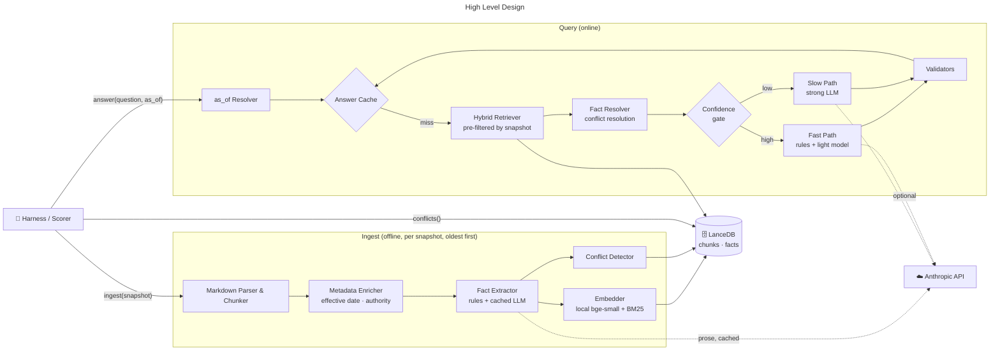
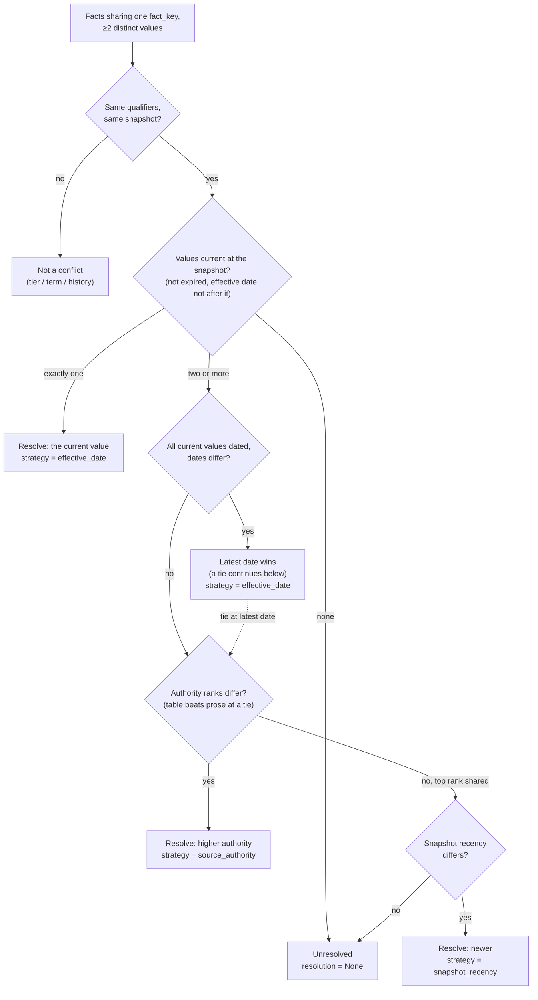
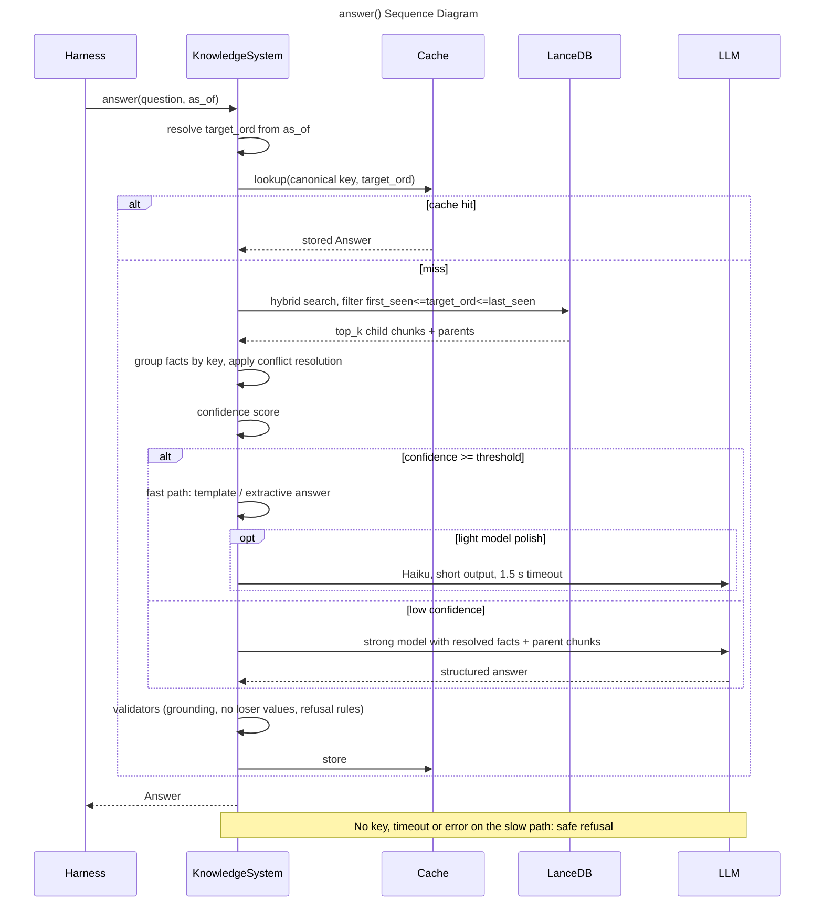

# Knowledge System Design

## Functional Requirements

* (ingest) Learn from each snapshot, oldest first: keep history, not just the latest copy of each page.
* (ingest) Detect contradictions between pages and resolve them methodically.
* `answer(question, as_of=None)`: answer a member question from the newest snapshot (`as_of=None`), or as the website stood on `as_of`.
* Answers carry the right-tier value, source URLs, and an honest `confident=False` when the website does not say.
* `conflicts()`: list every contradiction, the competing values, the value we believe, and the resolution strategy used.
* Answer paraphrased and repeated questions identically.

## Non-functional Requirements

* Accuracy - 55% of the score; target >78% on `public_eval.jsonl` (the original target was >90%; it was lowered by the owner after Step 10 measured 0.79 to 0.84 over repeated runs, and two public questions are disputed, see PROGRESS.md). Repeating a stale or wrong-tier value scores zero for that question, so correctness of the resolved value matters more than answer completeness. This is the primary optimisation target and wins every trade-off against speed.
* Consistency - Reworded questions (same `group`) and repeated questions must produce the same values. Achieved by determinism (answers rendered from resolved facts, canonical-key cache, LLM results cached by content), not by luck. The models take no temperature (see "Model choice and determinism"), so determinism of LLM calls comes from the cache.
* Latency - Speed is 15% and multiplied by accuracy. The original goal was a P99 of 1–2 s on the common path (fast path + cache). It was relaxed by the owner after Step 10 because accuracy is worth more than speed: the target is now that every answer finishes under the 20 s hard ceiling (the speed score reaches 0 there; the harness limit is 60 s), with the slow-path deadline at 15 s. Measured on the public eval (Step 10, five clean runs): all 40 questions went to the slow path, because the fast path's full-coverage check refuses most real wording, so p50 was 6.8 to 7.4 s, p95 8.1 to 10.5 s and the slowest answer 10.3 to 12.4 s; the speed score was about 0.53 to 0.66. The fast-path decision stage itself takes a median of 129 ms (slowest 247 ms), so a question the fast path does answer would be fast, but none of the public questions is one. Two runs showed answers far above the deadline (1,003 s and 115 s). In both, the power log shows the laptop in idle sleep while the evaluation ran, and the harness times each question with wall-clock time, so a question in flight during sleep reports the sleep as latency; the run itself was not at fault. Separately, the 15 s deadline wraps only the slow-model call: the query rewrite and rerank calls before it are bounded one by one (6 s each), not as a whole, so an answer can pass 15 s if those stages are slow (shown with an artificial 8 s delay on each: the answer came back after 16.2 s). Evaluation runs should keep the machine awake. Ingest takes minutes (target <5 min, hard limit 30 min), and ingest time is not scored.
* Availability/Failure Handling - Never raise from `answer()`. A missing API key, LLM timeout, rate limit or malformed LLM output degrades to the fast-path answer (non-confident when the evidence is weak). The system runs fully in-process with no server dependency, so there are no network dependencies other than the optional LLM. Ingest-time LLM extraction is cached on disk, so a rerun or a partial failure resumes cheaply.
* Scalability - ~700 pages × 5 snapshots, deduplicated to ≈5–15k chunks. This design is sized for that dataset, not for millions of documents. If the corpus grew by orders of magnitude, the embedded store would be swapped for a server vector DB (see Vector Database).
* Reproducibility - The same snapshots produce the same index and the same answers. LLM outputs used at ingest are cached by content hash. Current models accept no sampling parameters, so a cache miss or a changed prompt can give different LLM output (see "Model choice and determinism").
* Security - Only the provided snapshots are used (no live website calls). The Anthropic API key (`ANTHROPIC_API_KEY`) is read from the environment and never logged or persisted. Snapshot data is not redistributed (excluded from git). Dependencies are audited (`pip-audit`, `bandit`).
* Monitoring - Not in the hand-in, but the design logs structured per-query events (path taken, confidence, cache hit, latency, retrieved fact ids) and ingest counters. These feed the eval reports and would feed production dashboards.

## Design

### What each path uses

Chunks and facts are not split by path: both paths use both. The real difference is that the fast path answers only from facts and templates, while the slow path also reads raw text.

| Component | Fast path | Slow path |
|---|---|---|
| Chunks (raw text, in the vector store) | Retrieval searches them to find the matching facts; each fact points back to its chunk for the URL, quote and dates | The model reads the matched parent chunks (full table, header, footer note) |
| Facts (structured values, extracted at ingest) | The answer is built from the winning fact through a template | The model receives the resolved facts and conflict notes along with the chunks |
| Qualifiers and question extraction | Core of the match and of the confidence score | Run first anyway, because the confidence gate decides which path a question takes |
| Template | Renders the answer text; optional light-model polish, off by default | Not used; the model writes the answer from structured output |
| Validators | Yes | Yes |
| LLM | None by default (optional polish and cross-check flags) | Sonnet 5.5, structured output; also change-cue questions that do not qualify for the fast history template, which see the fact-history view |

Haiku also appears at ingest, to extract facts from prose (cached), and at ingest to verify table row-label parses. That is separate from answer-time use.

### Knowledge System Interface

The contract is fixed by `harness/contract.py`: `build()` returns an object with `ingest`, `answer` and `conflicts`. The harness imports `solution.py` in-process and calls the methods directly, so there is no network API, serialisation or authentication layer. The three methods map to three phases:

* `ingest(snapshot)` is called once per snapshot, oldest first, and must complete before the next call. It is not timed for scoring (30-minute limit for all five).
* `answer(question, as_of)` must finish within 60 s, and its p95 latency is scored.
* `conflicts()` reads the conflict table that ingest built. It performs no new analysis, so it is fast.

Only standard-library dataclasses (`Answer`, `Source`, `Conflict`) cross the boundary. Everything else is internal to a `kk` package (`submission/solution.py` is a thin shim that adds the package to `sys.path` and exposes `build()`).

#### Answer shape

* `text` - Concise and member-facing, containing only the winning value(s). Stale and loser values are never in `text`: the scorer zeroes an item if a `must_not_include` value appears.
* `sources` - `Source(url, snapshot_id, quote)` for the winning evidence. Citing the right page earns extra credit.
* `confident` - `False` for "the website does not say" and for unresolved ambiguity.
* `conflict_note` - Set when the answer touched a conflict; names the strategy and the loser. It is the only place loser values appear.
* Refusals (`should_refuse`) set `confident=False` and contain no digits (no phone numbers or rates), because the scorer treats any number beyond the question's as a stated value.

### `as_of` Handling

**The `as_of` field in the evaluation dataset is the sole source of the target date.** We do not extract a date from the question text with regex or a smaller LLM. That would add overhead and a failure mode to every query, and the harness already provides the date. Limitation (accepted): a question saying "as of May 2026" with `as_of=null` is answered as current.

`target_ord` is the 1-based ordinal of the snapshot that represents "the website as of the question date" (01_2026-05-12 = 1 … 05_2026-09-28 = 5).

* `as_of = None` → `target_ord` = the newest snapshot (5). All snapshots up to the latest are visible and the newest information wins.
* `as_of = D` → `target_ord` = newest snapshot with `taken_on ≤ D` (inclusive). Only snapshots ≤ D are visible; later snapshots are never read. Example: `as_of = 2026-05-31` → `target_ord = 2` (2026-05-19), which is why dup-006 answers 3.90% and not the later 4.00%.
* No snapshot ≤ D (D predates the first) → `confident=False` and a no-information answer, containing no digits.
* Each snapshot is the full website as of that date, so the state "as of D" is snapshot `target_ord`. A chunk is visible when its validity interval contains `target_ord`. A page that disappeared before `target_ord` is not visible.

**Refinement of the proposed metadata:** identical chunks recur across snapshots, so we store one row per unique chunk with `first_seen_ord`, `last_seen_ord`, `first_seen_date` and `last_seen_date` instead of one row per snapshot. The pre-filter is `first_seen_ord <= target_ord AND last_seen_ord >= target_ord`. It is equivalent to filtering "snapshot_date ≤ as_of" while avoiding up to 5× duplicate rows and duplicate retrieval hits. For `as_of=None` we use `target_ord = latest`, and the same filter works, so there is one code path. A row is extended to the next snapshot only if its text (`chunk_id`), `effective_date`, `expiry_date` and parent are all unchanged; if a table footer gets a new date, or a sibling row changes the parent table, the row starts a new interval (its vector is reused), so a stale date or parent is never served for a later ordinal.

### Vector Database

Options considered:

| | Embedded LanceDB (chosen) | Embedded Chroma | Server DB (Qdrant / Milvus / Elasticsearch) |
|---|---|---|---|
| Runtime dependency | none, in-process, on disk | none | Docker / server must be running |
| Metadata pre-filter | SQL predicates, filter before vector search | basic `where` | rich |
| Hybrid keyword search | built-in full-text (BM25) | not native | Elasticsearch/Qdrant yes |
| Fit with in-process harness | best | good | risky: the grader needs Docker |
| Ingest overhead (~10k chunks) | seconds | seconds | container start + network |

LanceDB is preferred because it satisfies the filter requirement (range of snapshots) natively, supports hybrid search without a second index, and removes the runtime dependency that would break the grader's in-process `build()`. Server databases win on horizontal scale and concurrent writers, neither of which this workload needs (single process, ≈10k rows, read-mostly). Docker is used only for the developer/CI toolchain.

#### Tables

chunks - one row per unique chunk.

* chunk_id - Text. Primary key. Hash of normalised content + url.
* url, file_name, title - Text.
* parent_headers - List of text. Root-to-section header path.
* chunk_type - Text. `text_paragraph`, `table_row`, or `table`.
* parent_id - Text. The table or section a child belongs to. Null for top-level chunks.
* text - Text. The embedded child text (a table row is rendered with its headers).
* vector - Vector(384).
* first_seen_ord, last_seen_ord - Integer. Validity interval in snapshot ordinals. Non Null.
* first_seen_date, last_seen_date - Date.
* effective_date, expiry_date - Date. Inferred from surrounding text. Null if absent (never defaulted to the snapshot date).
* source_class, authority_rank - Text, Integer. See Conflict Resolution.

facts - one row per unique (fact key, value, chunk).

* fact_id - Text. Primary key.
* entity, attribute - Text. Non Null.
* qualifiers - JSON (sorted keys). Term, tier or balance band, loan amount, model year, rate/APY/APR, personal/business.
* fact_key - Text. Hash of entity + attribute + qualifiers.
* value, unit - Normalised number and unit, or text.
* chunk_id - Foreign key to chunks, for provenance and the validity interval.

conflicts - rebuilt at the end of each `ingest`.

* conflict_id, topic, fact_key, values, sources (list), resolution, strategy, reason, snapshots (ordinals where the contradiction coexisted).

#### Non Primary Key Indices

* chunks: ANN vector index (IVF-PQ is unnecessary below ~100k rows, so use brute force or flat). A full-text index on `text` for BM25.
* facts: scalar index on `fact_key`, used by the resolver and conflict detector.
* No index on `effective_date` or `expiry_date`; they are read from retrieved rows.

### Chunking Strategy

Options compared:

| Strategy | Pro | Con |
|---|---|---|
| Fixed-size with overlap | trivial | splits tables, separates a rate from its tier header |
| Paragraph only | simple | a table row loses its column headers and the "effective as of" footer |
| Header-section | keeps topic | large chunks dilute embeddings; one 60 KB home-loan page |
| Whole table as one chunk | keeps tiers | poor row precision; large token cost |
| LLM propositions | precise | slow, costly, non-deterministic |
| **Hierarchical (chosen)** | precise match, full context | more parser code |

**Recommendation:** index child chunks and return their parents.

* `text_paragraph`: the paragraph is the chunk, returned as is, prefixed with its header path.
* `table_row`: the indexed text is self-contained, e.g. `Home Loans - Purchase | Program: Purchase 30-Year Fixed Conventional $100,000 or less | Rate: 7.13% | APR: 7.27%`. On a hit, the **parent table** is returned with its header row and its footer notes (the "Rates are effective as of…" paragraph that follows it). If the table exceeds the token cap, return the headers, footer and the matched row ± neighbours.
* Parent headers are the full path from the page title to the section.

Row-level matching gives precision for questions like "$100k tier, 30-year"; parent context gives the model the tier siblings, the footer and the effective date. The cost is a markdown table parser, which is worth it because rate tables are the main source of tier mistakes.

### Metadata and Effective Dates

Each chunk carries snapshot validity, file name and URL, parent headers, chunk type, `effective_date` and `expiry_date`. `effective_date` is inferred by rules from surrounding text: "effective as of 09/25/2026", "rates as of…", "offer ended 2025-09-30", "valid through…", and dated press-release headers. If nothing is found it stays null. `file_name` and URL path determine the source class and authority rank, used to compare chunks.

### Embeddings

Local `bge-small-en-v1.5` via fastembed (ONNX Runtime): 384 dimensions, CPU only, no PyTorch, no API key. Fused with BM25 by reciprocal rank fusion, because exact tokens ("17-month", "60 months", "$100,000") matter and dense vectors blur them.

| Option | Pro | Con |
|---|---|---|
| Local bge-small (chosen) | offline once the weights are present (bundled; a clone downloads them once), deterministic, free, fast | slightly lower quality than large models |
| Local bge-base / large | better recall | 3–10× slower ingest, more RAM on an 8 GB machine |
| API embeddings (Voyage, OpenAI) | best quality | needs network and key at ingest; non-reproducible |
| TF-IDF / hashed rules | trivial | weak on paraphrase ("lost debit card" vs "card replacement") |

Embedding happens in ingest only, so it does not affect answer speed. Vectors are also cached on disk by model fingerprint and text, so repeating an ingest (every `make verify` runs two) does not re-embed the corpus; the cache is only an optimisation and switches itself off on any error. Estimated <2 minutes for ~10k chunks on 8 cores (to be measured, and deduplication means only new chunks are embedded for each later snapshot). The model weights are bundled in the submission folder (`models/`, kept out of git), so ingest needs no download and works offline.

### Fact Model and Conflict Detection

A **fact** is one atomic claim:
`(entity, attribute, qualifiers, value, unit, chunk_id, effective_date, expiry_date, authority)`.
Example: `(mortgage, rate, {purchase, 30-year fixed, ≤$100k}, 7.13%)`. The **fact key** is `(entity, attribute, all qualifiers)`. Facts with different keys are different facts, never conflicts; this is how tiers, terms, rate vs APY and personal vs business stay apart.

Extraction happens entirely at ingest (never at query time): table rows by deterministic rules (see Table Fact Extraction); prose by a Haiku-class LLM (no temperature, see "Model choice and determinism"), cached on disk by chunk hash. Chunks unchanged from an earlier snapshot reuse their facts, so each later snapshot only pays for new or changed text. The conflicts table is built once, after the last snapshot, so `conflicts()` does no work at call time.

#### Qualifiers

Qualifiers are the details that distinguish one fact from its siblings: term, amount or balance tier, model year, rate vs APY vs APR, personal vs business. Example from the latest snapshot, under the heading "Home Loans - Purchase":

| Program | Rate | APR |
|---|---|---|
| Purchase: 30-Year Fixed Conventional $100,000 or less | 7.13% | 7.27% |
| Purchase: 30-Year Fixed Conventional $300,000 or less | 7.25% | 7.32% |

Row 1 gives entity "mortgage", qualifiers `{product: purchase, term: 30 years, rate_type: fixed, loan_type: conventional, amount_tier: ≤ $100,000}`, and the facts rate = 7.13% and APR = 7.27%. Row 2 differs only in `amount_tier` (≤ $300,000), so it has a different fact key and 7.13% vs 7.25% is not a conflict.

**How entity, attribute and qualifiers are identified.** For tables this is rule-based, and the rules come from patterns observed in the snapshots. The attribute comes from the column header, matched whole against an allow-listed lexicon built from the header survey (about 50 meaningful shapes, reviewed by hand; see Table Fact Extraction). The entity comes from the row-label column, or from the nearest heading when that heading matches a known product alias (aliases are built at ingest from page titles and headings). Qualifiers are parsed from the row label and qualifier columns by regexes written for the formats seen in the data: money ranges (`$100,000 or less`, `$25,000 – $99,999.99`, hyphen or en dash), terms (`30-Year`, `17-Month`), product words and model years (`2024-27`). A format the rules have not seen produces no fact (precision-first), not a guess. For prose, a Haiku-class LLM proposes entity, attribute and qualifiers at ingest, constrained to the same attribute names and qualifier keys, and the result is cached.

**Question-side extraction** reads the same details out of the member's question, using simple pattern rules (no model, well under a millisecond). The steps:

1. **Normalise** the wording to one standard form with hard-coded rules (regexes plus small word lists, such as the number words "five" → 5): "$100k" becomes 100000, "five year" and "5-year" become 60 months, "2025 model" becomes year 2025. The rules cover the phrasings seen in the public questions and the table formats, and are extended by adding a rule and a test, not learned.
2. **Spot the details** with small patterns and word lists: a number followed by month or year is a term; "or less", "under" or "between" next to a dollar amount is an amount tier; a year near "model" is a model year; rate, APY or APR names the measure; business or personal names the segment; product names come from the alias list built at ingest.

Example: "What is the APR for a five year auto loan on a 2025 model?" gives `{measure: APR, term: 60 months, model_year: 2025}`. The table row for the same loan carries `term: 60 months` and `model_year: 2024-27`, so the question matches it.

Ingest and answer share **one normaliser**, so "60-month" in a question and "60 months" in a table produce the same value.

**Principle: fail closed.** In plain terms: *when the fast path is not sure, it does not guess; it hands the question to the slow path.* The fast path returns an answer only when it fully understood the question and is confident in a single fact, and otherwise the question escalates to the slow path, which is slower (about 7 s against well under a second) but reads the full evidence. We deliberately accept higher latency in exchange for accuracy: a low-confidence fast answer is never returned, because a wrong answer scores zero and a slower correct one does not. "Closed" refers to the fast path's gate: it opens only for questions it can prove it understood, and everything else stays out. The cost is that most real questions take the slow path (all 40 public questions do in the current build, which is why the latency target was relaxed). A fast-path refusal happens only for a fully understood question whose answer the site does not give (for example a tier that is not published), and when the slow path itself is unavailable (no key, timeout) the safe refusal is the outcome, never a guessed fast answer.

Hand-written rules can never be shown to cover every phrasing, so the fast path must earn each question instead of being the default. A question is answered on the fast path only if the system can show it understood the whole question. Anything it cannot explain goes to the slow path. A *missed* detail is already safe (the qualifier-match score drops). A *wrong* detail is the real risk: a fact that matches the wrong value looks like a perfect match, and the validators cannot catch it because they check the answer against the same facts. Five guards address it, none of which add latency:

1. **Full-coverage check.** Each rule records the span of question text it consumed. After extraction, whatever remains must consist only of neutral words from a short allowlist ("what", "is", "the", "for", "a", "loan", "rate" and similar) and the entity tokens. Any other word or number sends the question to the slow path. This catches modifiers such as "over", "between", "at least", unparsed words such as the "half" in "a year and a half", and stray years such as "2022", including ones nobody anticipated, because an unknown word fails by default.
2. **Closed fast-path grammar.** The fast path handles only questions that fully match one of about 10 anchored patterns, for example `what is the {measure} for a {term} {product}` or `how many {entity}`. Each pattern has golden tests. A partial match is a non-match. The accepted questions are a short tested list, not an open-ended rule set.
3. **Sibling selection check.** When sibling facts differ only in a qualifier (the $100,000 and $300,000 tiers), the question must select exactly one of them. If it selects several tiers, or sits within a boundary of a tier edge, the question goes to the slow path, which applies the Tier Policy. If it selects none (no published tier or sibling matches, for example a $400,000 loan when the top tier is $300,000), a fully understood question is refused on the fast path. The fast path only answers a certain match with exactly one tier: precision comes before coverage.
4. **Qualifier contradiction rule.** A fact that carries a qualifier contradicting one the question stated is ineligible. A qualifier the question never mentioned sends the question to the slow path under the Tier Policy.
5. **Measured precision.** The calibration set includes questions with unusual modifiers, ranges and term phrasings. `τ_accept` is chosen so fast-path precision on a held-out split meets the target (about 97%). If it does not, the grammar is narrowed.

*Residual risk, stated openly:* these guards stop wording the rules do not recognise. They do not stop a recognised pattern that has a bug (for example "$1.5k" parsed as 15). That is covered only by golden and property tests on the normaliser and each pattern. The cost of the guards is a smaller fast-path share; the eval report shows that share. If more than about 5% of questions go slow, p95 latency becomes the slow-path latency, which costs a few points of the speed score (15% of the total). A wrong tier zeroes an item worth far more, so the trade is accepted.

#### LLM extraction: trade-off and decision

| | Rules + guards | LLM extraction (Haiku, constrained JSON) |
|---|---|---|
| Handles odd phrasing | no, falls to the slow path | yes |
| Latency | well under 1 ms | about 0.5–1.5 s on every question |
| Determinism | full | not guaranteed (the models take no temperature), which risks the consistency score |
| Failure mode | predictable and unit-testable | silent, plausible and varying |
| Needs the Anthropic API key | no | yes; without it, back to rules |
| Cost | none | one call per question |

An LLM does not remove wrong details; it trades testable mistakes for unpredictable ones. Decisions:

* **Query time:** rules plus guards 1–5. An optional **LLM cross-check** (rules and the LLM parse the question independently; the fast path runs only if they agree and the coverage check passes) is behind a flag, **off by default**. It is turned on only if the held-out calibration shows fast-path precision below target. When on, the LLM call runs in parallel with retrieval, is cached by normalised question, and is skipped for questions with no numbers or qualifier words.
* **Ingest time:** an LLM verifies each *distinct* table row-label parse once (offline, cached, no query latency). A disagreement quarantines that row's facts (same outcome as a failed plausibility gate). This checks the table side of every match for free.

#### Model choice and determinism

**Decision (Step 8): extraction uses Haiku 5.5 with no temperature, chosen for cost. This sacrifices determinism of the sampler.** Current models take no sampling parameters on the default API version (`2026-10-21`; the SDK sends it). On the older version `2023-06-01`, Haiku 5.5 accepts only `temperature` 1, and Haiku 4.5 is the only Haiku that accepts `temperature` 0. Measured with the real API (about 1.4 s per call on both): Haiku 4.5 at temperature 0 would cost roughly ten times more for the cold ingest (about $20 to $27 against about $2.70 for Haiku 5.5) and would depend on the older API version staying available. The owner chose Haiku 5.5.

What remains of determinism, and what does not:

* The extraction cache, keyed by prompt version, model, text and header path, returns the same result for the same input. The shipped cache makes grading ingest repeatable.
* On a cache miss, or when the prompt or model changes, the extraction model may return different output for the same text. The PRO-3 checks (attribute in the vocabulary, verbatim quote, every digit of the value in the quote) bound what a different output can contain, but they cannot make two runs agree.
* The same holds for the slow path (Step 10): the same question may phrase or choose differently on two uncached runs. Consistency there rests on the validators, the template-rendered fast path and the answer cache.

#### Extraction cache and the Anthropic API key

"Key" in this document means one of: the **Anthropic API key** (`ANTHROPIC_API_KEY`, the credential), a **fact key**, a **primary key**, or a **cache key**. The credential is always written in full.

At ingest the Anthropic API key is needed only for prose fact extraction; table rows use rules and need none. Without it the prose facts are missing, and prose questions fall to the slow path (which also needs the key) and are refused. To avoid depending on the key at grading time, **the extraction cache is shipped with the submission** (keyed by chunk content hash). If the hidden eval uses the same snapshots, ingest then needs no key and gives identical results every run. The cache holds text derived from the website data, so it is kept out of git like the snapshots and travels only inside the submission folder.

**Conflict definition (explicit call-out):** a conflict is a *coexisting contradiction*. Only facts with a numeric value take part; free text (prose, hours, address, phone, eligibility, status) has no normal form, so two different sentences about one entity are not a contradiction (SPEC decision 27). The same fact key carries different normalised values on different live pages within the same snapshot, including a stale or expired page that is still live (e.g. a promo page still showing an old rate). These are **not** conflicts: different tiers, terms or qualifiers; rate vs APY; formatting differences (`3.5%` = `3.50 %`); and a value that was simply replaced over time (that is history, queried through `as_of`). Conflicts are scanned over all snapshots and de-duplicated by (topic, value set).  The scan always covers all snapshots, not only the latest, because a planted contradiction may have been fixed later; the cost is possible extra entries for contradictions that no longer exist.

#### Conflict Resolution

Applied in order. The first step that separates the values decides, and **the strategy used is named in `Conflict.reason` and `Answer.conflict_note`**. The reference date is the `taken_on` of the snapshot being resolved (the snapshot `as_of` selects), never the wall clock.

0. **Current values only.** An expired value (`expiry_date` on or before the snapshot date) always loses, and so does a value whose `effective_date` is after the snapshot date (not yet in force). If exactly one value is current it wins (strategy `effective_date`); if none is, the conflict is unresolved.
1. **effective_date** - Among current values that all have an effective date, the latest wins. Values that tie on the latest date go on to step 2. If any current value has no effective date, the date comparison is skipped, because an undated page is not necessarily older.
2. **source_authority** - The more authoritative source wins: rate sheet / disclosure / fee schedule > product page > calculator > FAQ / learn article > blog > newsroom / press release / promo banner. At an equal rank a table fact beats a prose fact. Values that still share the top rank go on to step 3.
3. **snapshot_recency** (approved tie-break beyond effective date and authority; weaker evidence, and the reason text says so) - The newest snapshot / fetch time wins.
4. **unresolved** - `resolution=None`. Queries that touch the key return `confident=False` unless the slow path can justify a choice from the text.

**Design choice: if no competing value is current, the conflict is unresolved.** An expired value, or one whose effective date is after the snapshot, always loses, so "pick the best of the remaining values" only makes sense when something current remains. If every competing value is expired or not yet in force at the snapshot, the system does not rank the expired values against each other by effective date, authority or recency. That would present a value the site itself has withdrawn as the current one, and a confident wrong answer is the most expensive error here. The conflict is still reported (the contradiction existed), with `resolution=None` and a reason that says so (`strategy=unresolved: every competing value is expired: ...`). A question that touches the key returns `confident=False`, or is judged from the page text on the slow path. When exactly one value is current and the rest are expired or not yet in force, the current one wins as in step 0.

Every value in a `reason` is described the same way, winner first, so a reader can cross-check both sides: `<value> (<effective date or "no effective date">, <"live", "expired <date>" or "not yet in force">, [<evidence for the strategy>,] "<page title>")`. Titles are cut at 60 characters, at most three losers are named (the rest become "and N more"), and the winner is always complete. Example `reason`: `strategy=effective_date: 5.39% (effective 2026-09-25, live, "Auto Loan Rates") supersedes 5.34% (effective 2026-06-09, live, "Rate Calculator")`.

### Table Fact Extraction

**Principle: extraction is precision-first. Any doubt means no fact is emitted.** A wrong fact becomes a confident wrong answer that the validators cannot catch, because they check answers against the same facts. A missing fact (false negative) only sends the question to the slow path, which reads the raw table chunk. The one cost is that with no Anthropic API key the slow path cannot run, so a missed table becomes a refusal. Coverage is therefore measured (see Testing).

Observed in the snapshots: the latest snapshot has about 690 tables, of which about 330 have blank headers (layout tables, such as two columns of marketing bullets). Rate and fee tables come from a small set of repeating header shapes (about 50 meaningful shapes). Snapshots 01–03 had no new header shapes; snapshots 04–05 added about 170, in the sample all application forms, not rate tables.

#### Rules (deterministic, run at ingest)

1. **Detect and filter.** Find GFM pipe tables. A table with a blank header row, or with cells that are mostly lists, links or ` ` text, is a *layout table*. It is chunked as prose and goes through the LLM path.
2. **Normalise headers.** Strip footnote markers and escapes (`APY1` → `APY`, `\*Payment Example` → `Payment Example`) and lowercase. Match the **whole** normalised header against an allow-listed lexicon (no substring matching):

   | Header | Role | Attribute |
   |---|---|---|
   | Program, Account Type, Certificate, IRA Type, Loan Program | entity / row label | |
   | Balance, Balance Tier, Term | qualifier column | |
   | Dividend Rate | measure | `dividend_rate` |
   | APY, Annual Percentage Yield (APY) | measure | `apy` |
   | APR, Annual Percentage Rate | measure | `apr` |
   | Annual Percentage Rate (As Low As) | measure | `apr` with `bound: as_low_as` |
   | Rate | measure | `rate` |
   | Min. to Open, Min. to Earn | measure | `min_to_open`, `min_to_earn` |

   A header not in the lexicon emits no facts. It is logged and counted.
3. **Find the entity.** The entity column if present; otherwise the nearest preceding heading or bold line, accepted only if it resolves to a known product alias (aliases are built at ingest from page titles and headings).
4. **Parse qualifiers** from the row label and qualifier columns: money ranges (`$25,000 – $99,999.99`, `$100,000+`, `$100,000 or less`, hyphen or en dash), terms (`30-Year`, `17-Month`, `60 months` → months), product words (fixed/ARM, conventional/jumbo, purchase/refinance, often from a section heading) and model years (`2024-27`).
5. **Parse values.** Strip trailing footnote digits (`0.10%1` → `0.10%`). Parse percent, currency and integer. `None` and `—` become an explicit "none" value.
6. **Carry down** a blank row label from the row above.
7. **Attach the effective date** from the footer: scan the paragraphs after the table, up to the next heading, for "effective as of 09/25/2026" style patterns. The date goes on every fact in the table.
8. **Emit facts**: one per row per measure column; the fact key is entity + attribute + sorted qualifiers.

Worked example: `| Business 1st Rate Checking | $5,000 – $24,999.99 | 2.47% | 2.50%1 | — | $5,000.00 |` yields entity "Business 1st Rate Checking", qualifier `balance_band: 5,000–24,999.99`, `dividend_rate` 2.47%, `apy` 2.50%, `min_to_open` none, `min_to_earn` $5,000.00.

#### Table plausibility gates

Run on the whole table before any row becomes a fact:

| # | Gate | Passes when |
|---|---|---|
| P1 | Structure | At least 2 non-blank headers, a consistent column count, at least 1 data row |
| P2 | Entity anchor | An allow-listed row-label column, or a heading that resolves to a known product alias |
| P3 | Measure present | At least 1 column maps to an allow-listed measure |
| P4 | Value-type consistency | About 80% of each measure column's cells parse as the attribute's type (percent, dollar amount, "none"); failing rows are dropped |
| P5 | Qualifier coherence | A qualifier column holds one kind of value; money bands are ordered and do not overlap |
| P6 | Key uniqueness | No two rows give the same fact key different values |
| P7 | Cross-column invariants | Known relations hold, e.g. APY ≥ dividend rate, APR ≥ rate (to be verified against the data; they start as quarantine triggers) |

Outcomes, one logged decision per table: **ACCEPT** (facts emitted); **ACCEPT, inferred entity** (facts emitted with `entity_inferred=true` and a lower confidence cap); **QUARANTINE** for soft failures P5–P7 (no facts, flagged for review); **REJECT** for hard failures P1–P4 (the table goes down the prose path). Quarantine and reject behave like false negatives.

#### Mitigations against wrong mappings

Real cases from the data show why each exists:

| Mitigation | Case it prevents |
|---|---|
| Whole-header allow-list | `Category \| Interest \| Principal \| Remaining` must not become rate facts; `Annual Percentage Rate (As Low As)` must keep its "as low as" bound |
| Value-type check | Dollar amounts under a rate-like header are rejected |
| Table plausibility (P1–P7) | A creditor form with an `INTEREST RATE` column is rejected because its first column is not an allow-listed entity column |
| Mapping log and loud failure | Every table's decision is logged (`REJECTED, no entity column`); unmapped headers are listed |
| Snapshot diff | If a site rename makes the Share Savings APY facts vanish between snapshots, the diff flags it, and APY questions fall to the slow path rather than serving an older value |
| Hand-reviewed lexicon | The header histogram (about 50 meaningful shapes) is reviewed once; anything unreviewed is skipped |

**Optional hybrid (off by default):** an LLM proposes a role mapping once per distinct header shape (a few hundred, not per row), cached. A proposal is quarantined: it must pass the value-type check and the plausibility gates and be approved by a person before it is used.

#### Known hard cases

A landing-page table with only a `Balance` header shows 3.00% APY for the $5,000–$24,999.99 band, where the business pages show 2.50%. Whether that is a conflict depends on whether the entity resolves to the same product, which is the entity-matching problem. It gets explicit golden tests.

#### Testing

Golden tests per header shape (about a dozen rate and fee shapes); property tests for the money, term and percent parsers; a coverage report showing the share of data tables yielding at least one fact, with the list of unmapped headers.

### Query Path: Fast Path, Slow Path and Cache

* **Cache** - Key = (shape, entity, measure, sorted qualifiers, `target_ord`), built by the same rules as question extraction. Only questions that pass the full-coverage check are cached or looked up; a question that fails it is never served from the cache. Paraphrases share an entry when they parse to the same key. There is no embedding-similarity lookup, because "30-year" and "15-year" questions are close in embedding space and a near-neighbour hit could return the wrong tier. In memory and cleared by every `ingest` (SPEC decision 5). Failures and refusals caused by errors are not cached.
* **Fast path** - Hybrid retrieval (`top_k` ≈ 20 chunks, unrelated to `target_ord`) → fact resolver → a deterministic template or extractive answer, optionally polished by a light model (Haiku 5.5, short output, 1.5 s timeout). It fails closed: if it is not confident, or did not fully understand the question, the question goes to the slow path (higher latency, higher accuracy) instead of returning a risky answer (see Principle: fail closed).
* **Confidence score** - Computed locally from similarity, margin, qualifier match, entity match and the conflict-resolution state, with hard caps for missing templates, unresolved conflicts, aggregates, multi-page lists, and any question that fails the fail-closed guards in Qualifiers. Two calibrated thresholds, `τ_floor` and `τ_accept`, decide between refusal, the slow path and the fast answer. See Confidence Score and Thresholds below.
* **Slow path** - Strong model (Sonnet 5.5, Opus 5.5 configurable) receives the resolved facts, parent chunks and conflict notes, and returns structured output. It reads a deeper search (60 chunks) of the question and up to three rewritten queries, each prose hit with its neighbours and heading path; differing text statements are shown side by side, and only numeric conflicts block a value (SPEC 13.5, decisions 35 to 38). **Recency in prose (decision 47):** figures that change over time, such as a branch count, sit in sentences that are not extracted as facts, so the conflict table cannot rank them. The slow path therefore applies the same "latest date wins" principle itself: its first rule says that when evidence states different values for the same thing the one with the latest effective date, or the latest publication date for news and blog pages, is current, whatever page states it most directly or most often; and the payload names the newest dated evidence. The publication date stays a label (never an `effective_date`, no new facts, the extraction cache is untouched), so the resolution order for facts is unchanged. The newest copy of a sentence that changes between dated pages is also promoted to the front of the payload, so the 12,000 character cap cannot drop it in favour of older copies (decision 48); nothing is removed. Both steps help a model decision and are not deterministic: in 12 fresh runs of the branch-count question the latest value was given 11 times.
* **Validators** (both paths) - Every number in the answer appears in the cited evidence; no loser or stale value in `text`; refusal text has no digits and `confident=False`; the winner's URL is cited.
* **Tier policy** - When the question omits a qualifier such as the amount tier, see Tier Policy below. Only the slow path applies it.
* **Calibration** - Thresholds are calibrated on a training split of the public eval plus synthetic paraphrases, to avoid overfitting 40 questions.

#### Change and History Questions

The hidden set includes questions about things that changed between snapshots ("has the 17-month certificate rate changed?"). They differ from `as_of` questions: the member wants the difference, not the value at one date. `as_of` is still the only source of a target date; the question text is not parsed for dates.

* **Fast path (history template).** A question that fully matches an anchored history pattern ("has / did the {entity} {measure} change", "what was the {entity} {measure} before") is answered from stored fact intervals. For the one matching fact key, the system builds the value at each snapshot up to `target_ord` (using the conflict winner at that snapshot), groups consecutive equal values into segments, and renders the `history` template: "Yes - the 17-month certificate APY was 3.50% as of 2026-06-09 and had changed to 3.90% by 2026-08-27", or "No - ... has been 3.50% in every snapshot from 2026-05-12 to 2026-09-28". Snapshot dates only bound the change (it happened after one snapshot and no later than the next), so the wording says "as of" and "by", never an exact date.
* **Fast path only when the history is trustworthy.** The key must be present in every snapshot from its first appearance to `target_ord` (a gap could be an extraction miss, not a real change), no snapshot may have an unresolved conflict for it, its `(entity, attribute)` must not be degraded by the snapshot diff, and there must be at most 5 segments. Otherwise the question goes to the slow path.
* **Slow path (fallback).** A question with a change cue ("still", "used to", "since", "no longer") that does not match a history pattern goes to the slow path with a fact-history view: every distinct value with its validity interval up to `target_ord`, oldest first, plus pages added or removed. A status question such as "Is the Hy-Vee branch still open?" is not a history question; it uses the status template.
* **Validators.** Number grounding allows every segment value and the printed snapshot dates. The stale-value check is relaxed only for history answers, where earlier values are the point.
* **Without an Anthropic API key,** history questions that qualify for the fast path are still answered; the rest are refused.

#### Tier Policy

A **tier** is one level of a price list: the "$100,000 or less" and "$300,000 or less" mortgage rows, or a Share Savings balance band. The policy covers a question that does not say which tier it means, such as "What are the mortgage rates right now?" (dup-011) or "the interest rate for a 30-year mortgage" (dup-009). The aim is to give a defensible, labelled answer instead of dumping every tier, because the scorer zeroes an item if a wrong-tier value appears.

* **Detection.** The sibling selection check (guard 3 under Qualifiers) finds that the question matches several sibling facts that differ only in one qualifier, or sits on a tier boundary, and the confidence gate caps the question below `τ_accept`. A question that matches none of them is not capped; it is refused on the fast path.
* **Path.** The fast path never guesses a tier, so these questions go to the slow path. Without an Anthropic API key they are refused.
* **Default tier.** A per-attribute setting in a config file; the starting rule is the entry tier (the lowest amount or balance band). The answer states the tier it used ("for loans up to $100,000").
* **Other tiers.** The slow path receives all sibling facts, so it can mention others only as labelled alternatives. For a question about one specific product with no amount ("a 30-year mortgage"), it may give the range from the entry tier to the top tier. For a generic question ("mortgage rates"), it leads with the default tier and does not use another tier as the headline.
* **Validators still apply.** Every number must be a sibling fact on an in-scope key, and a stale or loser value is still rejected.

Status: this is a starting rule, not settled. dup-009 expects two tiers and dup-011 expects one, so the rule above (specific product gives a range, generic question gives the default) is a hypothesis to test against both, not a fitted one. See Reflections, item 5.

#### Failure Handling Matrix

`answer()` never raises. Each stage is wrapped, and every failure maps to a defined outcome:

| Failure | Detected by | Outcome |
|---|---|---|
| Fast path low confidence | confidence < threshold | Not a failure: escalate to the slow path |
| Fast answer rejected by validators (number not in evidence, loser value in text) | validators | Escalate to the slow path |
| Fast path raises (parser, LanceDB, resolver bug) | exception caught, logged | Escalate to the slow path |
| Light-model polish times out or errors | 1.5 s timeout / SDK error | Skip polish, return the deterministic template answer (polish is optional) |
| Slow path unavailable (no key, timeout, rate limit, malformed output) after a fast escalation | SDK error / schema validation | Safe refusal |
| Confidence below the relevance floor | confidence score | Safe refusal, without calling the slow path |
| No snapshot ≤ `as_of` | as_of resolver | Safe refusal (same shape) |

Safe refusal = `confident=False`, "not listed, please contact us", no digits, no sources.

**Policy (decided): err on the side of refusal.** There is no best-effort tier. A wrong or made-up number scores zero and breaks `should_refuse` items, and an honest refusal costs no more than a wrong answer on a normal item. A fast answer is returned only if it is validated and its confidence is at or above `τ_accept`. A slow-path answer is returned only if it is validated. Everything else is a safe refusal. Failures are logged and never cached, so the next call retries.

#### Confidence Score and Thresholds

Confidence `c` ∈ [0, 1] is computed locally from the retrieval and fact-matching results, with no LLM call:

| Signal | How it is computed |
|---|---|
| Similarity | Top hit's raw dense cosine similarity and its BM25 score normalised by the best score possible for that query, averaged. RRF is used only to rank results, never to score confidence, because it uses ranks and discards magnitude |
| Margin | Gap between the top fact's score and the runner-up's (a small gap means ambiguity) |
| Qualifier match | Qualifiers extracted from the question by rules (terms like "60-month", amounts like "$10,000", model year, rate/APY/APR, personal/business) vs those on the candidate fact key: matched ÷ required |
| Entity match | Question entity tokens vs the fact's entity, using an alias list built at ingest from titles and headers, plus embedding similarity |
| Resolution state | Unique winner 1.0; conflict resolved by strategy 1 or 2: 0.9; by strategy 3: 0.7; unresolved: 0 |
| Template available | Whether a template exists for the question shape |

`c` = a weighted sum of the first four signals, multiplied by the resolution state, with hard caps below `τ_accept` when the question fails the full-coverage check or does not match the fast-path grammar (see Qualifiers), when no template exists for the (shape, attribute type) pair, when the conflict is unresolved, when the question is an aggregate, or when it is a list whose items span more than one page or section (completeness cannot be guaranteed, e.g. dup-034 across personal and business card pages). These always go to the slow path. A list whose items all come from a single table is complete by construction and may use the list template.

Two thresholds, with a clear meaning each:

* `τ_floor` (**relevance floor**): below it nothing relevant was found. Refuse immediately, without calling the slow path.
* `τ_accept`: at or above it (and validated) the fast answer is returned. Between `τ_floor` and `τ_accept`, escalate to the slow path.

**These are not fixed percentages like "80% relevant".** Raw cosine similarity is not comparable across question types, so the thresholds are calibrated, not guessed:

1. Build a labelled calibration set: the 40 public questions, plus questions auto-generated from the facts table (e.g. "What is the {attribute} for {qualifiers}?" with the known value as gold), plus negatives (attributes or qualifiers that do not exist, such as the 7/1 ARM) and dev-time paraphrases. The generated questions are fixtures committed to `tests/`, not produced at runtime.
2. Compute `c` for each item and label the fast answer correct, wrong, or should-refuse.
3. Choose `τ_accept` as the lowest value where the fast path's precision is at least a target (e.g. 97%); choose `τ_floor` as the highest value where almost no answerable item falls below it.
4. Choose on a training split, report on a held-out split, and record the calibration curve and values in a config file with their provenance. The weights start hand-set and are tuned only coarsely (two thresholds and a few weights) to limit overfitting.

The design commits to this method and to the precision target. The actual numbers are produced during implementation and verified by the eval gate.

**Slow path "confidence":** it does not compute a relevance score. The LLM returns structured output (`answerable`, `answer`, `evidence_ids`). The answer is accepted only if `answerable` is true, every `evidence_id` was in the retrieved set, and the validators pass. The model's self-reported certainty is not trusted on its own, since it is poorly calibrated.

#### Validators

Run on both paths, after generation. The answer is rejected (escalate, or refuse if already on the slow path) if any check fails.

1. **Number grounding** - Extract numbers from `text` using the scorer's own normalisation (value + unit, so `3.5%` = `3.50 %`). Every number must be in the allowed set: the winning fact value(s), qualifier numbers on the winning fact keys (tier amounts, terms, model years), and numbers in the question.
2. **Stale/loser check** - For the fact keys in scope, the system knows every other value seen: losers from the conflicts table, values from earlier snapshots, and expired values. If `text` contains a number that is a known loser for an in-scope key and not a winner for any in-scope key, reject. If the text mentions a different tier's value, that tier's key is out of scope for this answer and the value is rejected by check 1.
3. **Refusal shape** - A refusal has `confident=False` and no digits.
4. **Citation** - Cited URLs are those of the winning evidence.

Limit (stated openly): the stale check can only catch stale values that were extracted as facts. A stale number on a page that never became a fact is caught only by check 1 (it is not in the allowed set), which is why check 1 is the main safeguard.

#### Answer Rendering: Templates and Polish

A **deterministic template** turns the winning fact(s) into the answer text with no model involved. Templates are **hand-written by developers** (about 10, versioned in code and unit-tested), not generated and not chosen by BM25 or embeddings. Retrieval finds the facts; a rule-based classifier then picks the template from (the fact's attribute type, the question shape), and the template's slots are filled from fact fields. Examples:

* rate: `The {qualifier phrase} {entity} {attribute} is {value}{unit}.` → "The 60-month rate for 2024–27 model years is 5.39% APR."
* fee: `The {entity} fee is {value}.`
* count: `{entity}: {value}.`
* yes/no and closure questions: `No - {entity} {state} {date}.`
* list: facts sorted by a fixed key and rendered one per line.
* prose facts (hours, eligibility): the extracted sentence, quoted.

The question shape (what/how many/is it open/list) is classified by rules over keywords. A shape with no template is capped below `τ_accept` and goes to the slow path. Same facts always give the same text, which supports consistency.

**Light-model polish** is an optional step that asks Haiku to rephrase the template text into more natural wording. It sees only the template text, must keep every number unchanged, and the result is discarded if its set of numbers differs from the template's. The scorer is value-based, so polish adds no score and costs latency and a tiny determinism risk. **Decision: polish is off by default and stays behind a flag**, to be turned on only if an ablation shows an LLM-judged quality gain. The number check is strict and can discard a correct rephrasing: "2024–27 model years" rewritten as "2024–2027" changes the number set ({2024, 27} vs {2024, 2027}) and is thrown away.

#### Template Catalogue and Selection

Templates are generic per attribute type, not per fact. The slots carry everything that varies, which is why about ten templates cover the data. They are hand-written, versioned in code and unit-tested. They are not generated from the documents and are not chosen by BM25 or embeddings. The wording below is a design sketch to be finalised in implementation.

| Type | Template | Rendered example |
|---|---|---|
| rate | `The {entity} {attribute} for {qualifiers} is {value}.` | "The auto loan APR for a 60-month term, 2024–27 model years is 5.39%." |
| fee | `The {entity} fee is {value}{per}.` | "The lost debit card replacement fee is $2.50." |
| count | `There are {value} {entity}.` | "There are 22 branch office locations." |
| address | `The {entity} is at {address}.` | "The Galena Branch is at 11375 Oldenburg Lane, Galena, IL 61036." |
| hours | `{entity} hours are {hours_text}.` | "Drive-up hours are Monday–Friday 8 a.m.–6 p.m." |
| status | `{Yes/No} - {entity} {status_phrase} {date}.` | "No - the Hy-Vee branch was scheduled to close March 31, 2026." |
| list | `{intro}:` then one `- {item}` per line, each item rendered with the rate or fee template | "Credit cards:" then a line per card with its APR |
| quoted prose | `{entity}: "{sentence}"` | "Membership: "People who live or work in…"" |
| history | `Yes/No - the {entity} {attribute} for {qualifiers} was {v1} as of {d1} and had changed to {v2} by {d2}.` (or `has been {v} in every snapshot from {d1} to {d2}`) | "Yes - the 17-month certificate APY was 3.50% as of 2026-06-09 and had changed to 3.90% by 2026-08-27." |
| refusal | `I couldn't find {the question's own phrase} on Dupaco's website. Please contact Dupaco.` | no digits, no sources |

When the question does not say whether it wants the rate or the APR, the rate template shows both from the same row ("7.13% rate / 7.27% APR"). When it does, it shows only the one asked about.

**Selection.** Two inputs are known before rendering: the winning fact's *attribute type* (set at extraction by header and keyword rules) and the *question shape*, from an ordered list of regex and keyword rules: "how many" → count; starts with is/are/does/can/was → yes/no; "when does" → date; "which/what … do you offer", "list", "types of" → list; otherwise → what. A lookup table maps the pair to a template:

| Shape | Attribute type | Template |
|---|---|---|
| what | rate / fee | rate / fee |
| how many | count | count |
| what, where | address | address |
| what, when | hours | hours |
| yes/no | status | status |
| list | any (single-table group) | list |
| any | prose | quoted prose |
| anything else | | none, so the question goes to the slow path |

**Slot derivation** (all from stored fields on the winning fact, no model involved):
* `{entity}`: the display label saved at extraction, kept as close to the source wording as possible (section header plus row label with the qualifier text stripped).
* `{attribute}`: the column header, e.g. APR or APY.
* `{qualifiers}`: the qualifier key-values, each rendered by a fixed map and joined in a fixed order (`term=60` → "a 60-month term", `amount_tier=100000` → "loans of $100,000 or less", `model_year=2024-27` → "2024–27 model years").
* `{value}`: the normalised number shown in the source's format (5.39%, $2.50).
* `{date}`, `{status_phrase}`: the fact's `effective_date` or closure date, formatted "March 31, 2026".
* Yes/No compares the fact's date with the **target snapshot date**, not the wall clock (a closure on 2026-03-31 is before the latest snapshot, 2026-09-28, so the answer is "No"). This matches the rule that dates are never parsed out of the question.
* Quoted prose: the sentence comes from LLM extraction at ingest, and a validator checks it appears verbatim in the source chunk.

**Coverage.** The set of attribute types comes from the data: after the first ingest, a histogram of extracted attributes and the question shapes in the public eval guide which templates to write. A question with no matching template is not an error; it goes to the slow path, with the validators still applied. The eval report shows the share of questions answered by a template. Having an LLM draft candidate templates at development time (human-reviewed, then committed) is a possible later option and is not part of v1.

#### Worked Examples

All numbers in the confidence and calibration examples are illustrative; the real values come from the calibration step.

**Validators (dup-016, "APR for a 60-month auto loan on a 2025 model-year vehicle?").** Winner: `(auto loan, apr, {60 months, 2024-27}) = 5.39%`. Known loser: 5.34% from a stale page. Allowed numbers: 5.39, 60, 2024, 27, 2025 (from the question).

| Candidate text | Check | Result |
|---|---|---|
| "The 60-month rate for 2024–27 model years is 5.39% APR." | all numbers allowed | pass |
| "5.39% APR, up from 5.34% on an older page." | 5.34 is a known loser for an in-scope key | reject (the scorer would zero it) |
| "5.49% APR." | 5.49 is not in the allowed set | reject (grounding check) |

The loser value appears only in `conflict_note`, e.g. `strategy=effective_date: 5.34% superseded by 5.39%`.

**Confidence (illustrative weights: similarity 0.30, margin 0.20, qualifier match 0.30, entity match 0.20; `τ_floor` = 0.30, `τ_accept` = 0.80).**
* dup-016: similarity 0.9, margin 0.8, qualifiers 3 of 3 (60 months, 2025 falls inside the 2024–27 tier, APR), entity 1.0. Raw 0.93; the conflict was resolved by effective date, so × 0.9 = **0.84**, fast path.
* dup-011, "mortgage rates right now": similarity 0.85, margin 0.2 (many tiers score alike), qualifiers 0 of 2, entity 1.0. Raw **0.50**, between the thresholds, slow path (which applies the tier policy and leads with the $100k tier).
* dup-145, 7/1 ARM rate: similarity 0.55, margin 0.1, qualifiers 0 of 1, entity 0.2. Raw **0.23**, below `τ_floor`, immediate refusal with no LLM call.

**What happens to a fast answer.** dup-016 (c = 0.84) is validated and above `τ_accept`, so it is returned. dup-011 (c = 0.50) escalates; with an Anthropic API key the validated slow answer is returned, without one it refuses. A fast-path exception is treated like the second case. A run with **no Anthropic API key** therefore refuses every question that needs the slow path, which NOTES.md must state.

**Calibration.** Labelled items sorted by c (made up):

| c | Item | Fast answer was |
|---|---|---|
| 0.22, 0.28 | negatives (should refuse) | n/a |
| 0.35, 0.52 | answerable | wrong |
| 0.66 | answerable | right |
| 0.71 | answerable (tier error) | wrong |
| 0.84, 0.88, 0.93, 0.95 | answerable | right |

`τ_accept` is the lowest cutoff above which fast precision is at least 97%: everything at or above 0.84 is correct and 0.71 is the last wrong one, so it lands in (0.71, 0.84], here 0.80. `τ_floor`: negatives top out at 0.28 and answerable items start at 0.35, so it lands near 0.30.

**Polish.** The template text "The 60-month rate for 2024–27 model years is 5.39% APR." rephrased as "…2024–2027 model-year vehicle, the APR is 5.39%" changes the number set ({60, 2024, 27, 5.39} vs {60, 2024, 2027, 5.39}), so the polish is discarded although it is correct. This is one reason polish is off by default.

### Consistency

Determinism end to end: LLM results cached, answers rendered from resolved fact ids rather than raw text, canonical-key cache, stable tie ordering. The scorer compares the set of numbers in answers, so paraphrases that map to one fact key return identical numbers.

### Evaluation and Verification

Baseline is the starter (0.093). Reports show accuracy by category, consistency, conflict F1 (selftest gold plus a hand-built gold list), and latency P50/P95/P99 from `harness/run_eval.py`. Ablations: no `as_of` filter, no conflict resolution, fast-only, slow-only.

## Technology Choices

| Area | Choice | Purpose |
|---|---|---|
| Language | Python ≥3.10 (developed on 3.12) | Matches the harness |
| Dependency management | uv (`pyproject.toml` + lockfile), exported `requirements.txt` | Reproducible installs; `requirements.txt` is required by the hand-in |
| Vector database | LanceDB (embedded) | Pre-filtered hybrid search, in-process (see Vector Database) |
| Embeddings | fastembed, `bge-small-en-v1.5` | Local, deterministic ingest |
| Markdown parsing | `markdown-it-py` | Structure-aware tables, headers, paragraphs |
| LLM client | `anthropic` SDK; Haiku 5.5 (light), Sonnet 5.5 (slow, Opus 5.5 configurable) | Prose fact extraction at ingest, slow path at query |
| Data models | `dataclasses` + `pydantic` for internal structures | Typed chunks, facts, config |
| Formatting and linting | ruff (lint + format) | Python equivalent of the Checkstyle/Spotless role |
| Static types | mypy `--strict` | Catches type bugs |
| Static security | bandit, pip-audit | Code and dependency vulnerability scan |
| Testing | pytest, pytest-cov, hypothesis | Unit, integration and property tests |
| Runtime analysis | `python -X dev -W error`, memray, cProfile | Warnings as errors, peak memory of ingest, latency profile of `answer()` |
| Build | `python -m build`, Makefile | One entry point for local and CI |
| Packaging and local setup | Docker, Docker Compose | Reproducible toolchain; no runtime DB service |
| Pre-commit | pre-commit | Runs ruff and mypy before each commit |

### Python and uv

The harness and starter are Python, and `build()` is imported in-process, so Python removes any bridging layer. `uv` gives a locked, fast, reproducible dependency set. Because the hand-in needs `requirements.txt`, it is exported from the lock file instead of maintained by hand.

### LanceDB and fastembed

See Vector Database and Embeddings. The pair keeps the whole system runnable with `pip install` and no servers. Alternatives are described above.

### ruff, mypy, bandit, pip-audit

These run as part of `make verify`, so a change that violates them fails the build:

* **ruff** - lint rules `E,F,I,N,D,B,UP,S,PL` and the formatter. This replaces Checkstyle/Spotless; formatting is applied automatically.
* **mypy --strict** - on the `kk` package.
* **bandit** - static security checks.
* **pip-audit** - known-vulnerability scan of locked dependencies.

Coverage thresholds (pytest-cov) apply to the extraction, resolution and as_of packages, where the core logic lives.

### Runtime analysis

* Tests run with `python -X dev -W error` so warnings (resource leaks, deprecated calls) fail the build.
* `memray` records peak memory of ingest on the real snapshots; the budget must fit comfortably in 8 GB.
* The eval gate runs the public eval and fails if p95 is more than 0.5 s worse than the recorded baseline (the slow path dominates p95; see Non-functional Requirements).
* `cProfile` output is archived when a latency regression is flagged.

### Build and verify

`make verify` runs in this order and fails fast: ruff check → ruff format --check → mypy → bandit + pip-audit → pytest with coverage → `python -m build` → public-eval gate (accuracy must not regress; p95 within 0.5 s of the baseline). The same target runs locally and inside Docker.

### Docker and Docker Compose

`docker compose` defines two services for the toolchain, not for runtime:

* `verify` - runs `make verify` in a pinned `python:3.12-slim` image with the model cache pre-baked.
* `eval` - runs `python harness/run_eval.py --submission submission --eval eval/public_eval.jsonl` and writes the report to `results/`.

There is no database service, because LanceDB is embedded. The submission folder runs without Docker.

## Skills

Two project skills with **distinct names**. Each states that it supersedes the user-level `design-drift-prevention` and `code-change-practices` for this repository (those were written for another project). The skills live in `.claude/skills/`:

* `design-drift-detection` - before any code change, reads the relevant DESIGN.md sections and compares the change with them. If the change would differ from the design, it surfaces the drift with a proposed next step and alternatives, and asks the user to choose.
* `verification-first-change` - runs the public eval before any edit to get a baseline, makes the change, reruns the eval, asserts that accuracy improved (or, for refactors, did not regress), and gets the user's approval before committing.

## Reflections / Open Items

### Most challenging decision
Whether to answer from retrieved text or from resolved facts. Text-only answers are simpler but let a stale paragraph with a plausible number through, and the scorer zeroes any stale value. Resolved facts give correctness and consistency, but they add an extraction layer whose qualifier normalisation ("60-month" vs "5 year", "$100k" vs "$100,000") is the likeliest place for silent errors. The compromise is rule-based table extraction, cached prose extraction, a validator that checks every number against evidence, and the slow path as a safety net.

### Risks and open items
1. Embedding weights are bundled in the submission folder (decided), since an offline grader would make a download a total-failure risk. A clone of the repository has no weights, so its first build downloads them once; a packaged submission never uses the network (SPEC decision 50).
2. The `first_seen/last_seen` interval refinement and the `snapshot_recency` tie-break (step 3) are approved additions to the original proposal; revisit if the eval shows they hurt.
3. Confidence thresholds calibrated on 40 questions can overfit. Mitigated by synthetic paraphrases and a held-out split.
4. LLM extraction nondeterminism, mitigated by caching, the verbatim-quote and digit checks (PRO-3) and ingest-time verification; sampling cannot be pinned (see "Model choice and determinism").
5. Tier policy against the public eval: dup-009 expects both 7.13 and 7.25, dup-011 expects one tier only. The Tier Policy rule (specific product gives a range, generic question gives the default tier) is a hypothesis that must hold on held-out paraphrases, not only on these two questions.
6. Questions that mention a past date in text while `as_of=null` are answered as current (by design).
7. Ingest time depends on the number of fact-bearing prose chunks sent to the LLM; not yet measured. Calls run concurrently, results are cached, and the shipped cache removes the cost at grading time.
8. The question-shape and qualifier rules and the alias-list construction are the hardest rule-based parts; they get golden tests and are specified in SPEC.md. Their residual risk (a recognised pattern with a bug) is covered only by tests; the fail-closed guards shrink the fast-path share, which must be measured.
   - Whether to enable the query-time LLM cross-check depends on the calibration result.
9. The cross-column invariants (APY ≥ dividend rate, APR ≥ rate) must be verified against the full data before they are enforced; they start as quarantine triggers.
10. A run with no Anthropic API key refuses every question that needs the slow path; NOTES.md must say so.

### What I would improve with more time
Add a learned reranker, extend the gold conflict set beyond what I can derive by hand, and run a larger paraphrase eval to tune the cache threshold.
